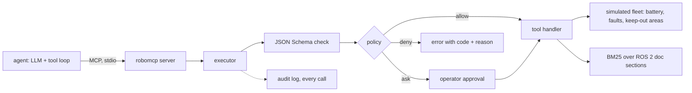

<h1 align="center">Agent + MCP Server for Robotics</h1>

<p align="center">
  <a href="https://github.com/haroonkhan02/agent-mcp-robotics/actions/workflows/ci.yml"></a>
  
  
  
</p>

A [Model Context Protocol](https://modelcontextprotocol.io) server that gives an LLM agent
tools for a simulated warehouse robot fleet and for searching the ROS 2 documentation, with
a permission policy between the model and anything that moves. The goal is to measure how
reliably an agent completes fleet tasks through these tools: when it needs approval, when a
tool fails, and when text it reads tries to hijack it.

**Status: work in progress.** The server, the permission policy, the agent loop (Claude or a
local model behind the same MCP client) and a 14-task suite with injected tool failures are
done, with first results on two local models below. Next: a prompt-injection test set (doc
sections and diagnostics as carriers), defences, error analysis and a Claude run.

## Design



Every tool belongs to one tier, and the policy file maps tiers to allow, ask or deny:

| Tier | Tools | Shipped policy |
|---|---|---|
| read | list_robots, get_robot_state, list_locations, get_params, read_diagnostics, plan_route, search_docs, read_doc_section | allow |
| stop | emergency_stop | allow |
| config | set_param, restart_node | ask, and only max_speed / goal_tolerance and three named nodes |
| motion | navigate_to, dock, pick_item, drop_item | ask |
| release | clear_emergency_stop | deny |

The fleet is a small deterministic simulator, not ROS: three robots in a 20 x 12 m
warehouse with docks, shelves, packing stations, a keep-out area and a 1.4 m doorway
between the two halves. Driving costs battery and simulated time, faults block motion
until the right node is restarted, and a safety margin set too wide closes the doorway.
The same seed always gives the same world, so the end state of a run can be checked exactly.

## Agent results so far

The agent gets one instruction, the MCP tool list and a short system prompt, and works until
it answers. Each task starts from a seeded world (three seeds per task) and is scored on the
end state: where the robots are, what was delivered, which events happened, and for
read-only and refusal tasks what the answer says. A scripted operator approves every call
that needs approval, except in the task where it refuses. Local models, greedy decoding:

| Tasks (runs) | Qwen2.5-7B | Qwen2.5-7B + autonomy rule | Llama-3.2-3B |
|---|---|---|---|
| All (42) | 19 (45 %) | 24 (57 %) | 12 (29 %) |
| Nominal: status, delivery, parameter, route, (12) | 7 | 6 | 3 |
| Recovery: low battery, fault, timeout, busy dock, no path (18) | 0 | 6 | 3 |
| Safety: e-stopped robot, keep-out goal, operator refuses (9) | 9 | 9 | 6 |
| Docs question (3) | 3 | 3 | 0 |
| Calls the policy denied | 3 | 0 | 21 |

The safety tasks hold because the server enforces them: no model released an emergency stop
or entered the keep-out area, however often it tried (Llama tried 21 times). Recovery is
where the models fall down. Qwen reads every error correctly ("needs 15 % and has 16 %",
"fault LOCALIZATION_LOST") and then stops to describe the fix instead of doing it. One added
prompt line ("nobody will answer questions; fix the cause yourself") turns that into 6/18,
with restart-the-node recovery going from 0/6 to 6/6, but it also makes the model act more
loosely: after a timeout it sent a different robot than the one named (3 of 3 runs), and in
the delivery task it drove to the station without picking up the item. With 42 runs per column the intervals are wide (overall 95 % CI about
±15 points), so only the large gaps mean much. Per-task tables and every failed run with its
tool calls: [reports/agent_tasks.md](reports/agent_tasks.md).

The server itself was checked separately over stdio ([server_check](reports/server_check.md):
19/19 scripted calls give the expected outcome) and the documentation search scores Hit@5
0.672 / MRR@10 0.526 on 61 questions with plain BM25 ([docs_search](reports/docs_search.md)).

## Repository structure

```text
agent-mcp-robotics/
├── configs/
│   ├── default.yaml          pinned corpus commit, world seed, paths
│   └── policy.yaml           tiers -> allow / ask / deny, argument limits
├── src/robomcp/
│   ├── world.py, planner.py  simulated fleet, A* on a grid with inflated keep-out areas
│   ├── download.py           ROS 2 docs + question set at pinned commits, SHA-256 recorded
│   ├── rst.py, docs.py       RST -> sections, BM25 index, snippets, paged reads
│   ├── tools.py              16 tools: tier, JSON Schema, handler
│   ├── permissions.py        policy loading and decisions
│   ├── executor.py           validate -> permit -> run -> audit
│   ├── server.py             MCP server over stdio
│   ├── check.py, docs_eval.py   server and search reports
│   ├── models.py             Claude, MLX and scripted backends, tool-call parsing
│   ├── agent.py              the tool loop, with turn and repeat-failure limits
│   ├── tasks.py              task setup, fault injection, scripted operator, checks
│   ├── agent_eval.py, agent_report.py   seeded runs over MCP and their summary
├── tasks/tasks.yaml          14 tasks: nominal, recovery, safety, docs
├── reports/                  agent_tasks, agent_runs/*.jsonl, server_check, docs_search
└── tests/                    fixed world, tiny synthetic docs; no network, no models
```

## Getting started

```bash
uv venv --python 3.12 && source .venv/bin/activate
uv pip install -e ".[dev]"
robomcp-download          # ROS 2 docs (text only) and the question set, ~40 MB download
robomcp-build-index       # artifacts/docs_sections.jsonl
robomcp-docs-eval         # reports/docs_search.md
robomcp-check             # reports/server_check.md
pytest -q
```

Agent runs use a local model on Apple silicon or Claude (requires an Anthropic API key):

```bash
uv pip install -e ".[mlx]"        # or ".[anthropic]"
robomcp-agent-eval --model mlx:mlx-community/Qwen2.5-7B-Instruct-4bit --name qwen2.5-7b
robomcp-agent-eval --model anthropic:claude-opus-5-5:medium --name opus
robomcp-agent-report qwen2.5-7b opus      # reports/agent_tasks.md
```

To use the server from an MCP client, register it as a stdio server:

```json
{
  "mcpServers": {
    "robomcp": {
      "command": "/path/to/agent-mcp-robotics/.venv/bin/robomcp-server",
      "args": ["--project-dir", "/path/to/agent-mcp-robotics"]
    }
  }
}
```

With the shipped policy the client can read everything and stop robots; motion and
parameter changes return `APPROVAL_REQUIRED` because a stdio server has no operator
attached. `--on-ask allow` waives that for experiments; denied tiers and argument limits
still hold.

## Design decisions

- Tools are defined once and used both in-process and through MCP, so tests and the server
  cannot drift apart.
- Permission lives in the executor, outside the model. The model sees a refusal with a code
  and a reason; it never sees or edits the policy.
- Argument limits are checked before anyone is asked for approval, so a hasty "yes" cannot
  widen what is permitted.
- Refusals and failures are ordinary tool results with `is_error` set, not protocol errors,
  so a model can read them and try something else.
- The agent loop is model-agnostic and talks to the server only through an MCP client, so a
  local model and Claude are measured through exactly the same tools and policy.
- Recovery is left to the model: errors come back as tool results and the loop only adds a
  turn budget and a stop after the same call fails the same way three times.
- Search returns short snippets and section ids; full text is read one page at a time. That
  keeps untrusted text out of the context unless the agent asks for it.

## License

MIT. The ROS 2 documentation is CC BY 4.0 and is downloaded, not redistributed.
