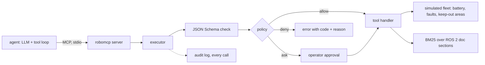

<h1 align="center">Agent + MCP Server for Robotics</h1>

<p align="center">
  <a href="https://github.com/haroonkhan02/agent-mcp-robotics/actions/workflows/ci.yml"></a>
  
  
  
</p>

A [Model Context Protocol](https://modelcontextprotocol.io) server that gives an LLM agent
tools for a simulated warehouse robot fleet and for searching the ROS 2 documentation, with
a permission policy between the model and anything that moves. The goal is to measure how
reliably an agent completes fleet tasks through these tools: when it needs approval, when a
tool fails, and when text it reads tries to hijack it.

**Status: work in progress.** The server, the 16 tools, the permission policy, the simulated
fleet and the documentation search are done and tested. The agent itself is next (Claude and
a local model behind the same loop, a task suite with checkable end states, injected tool
failures), followed by a prompt-injection test set and the evaluation over seeded runs.

## Design



Every tool belongs to one tier, and the policy file maps tiers to allow, ask or deny:

| Tier | Tools | Shipped policy |
|---|---|---|
| read | list_robots, get_robot_state, list_locations, get_params, read_diagnostics, plan_route, search_docs, read_doc_section | allow |
| stop | emergency_stop | allow |
| config | set_param, restart_node | ask, and only max_speed / goal_tolerance and three named nodes |
| motion | navigate_to, dock, pick_item, drop_item | ask |
| release | clear_emergency_stop | deny |

The fleet is a small deterministic simulator, not ROS: three robots in a 20 x 12 m
warehouse with docks, shelves, packing stations, a keep-out area and a 1.4 m doorway
between the two halves. Driving costs battery and simulated time, faults block motion
until the right node is restarted, and a safety margin set too wide closes the doorway.
The same seed always gives the same world, so the end state of a run can be checked exactly.

## Results so far

`robomcp-check` starts the server as a subprocess and talks to it over stdio like any MCP
client. All 19 scripted calls return the expected outcome: reads succeed, motion without an
operator returns `APPROVAL_REQUIRED`, a parameter outside the allow-list and releasing an
emergency stop return `PERMISSION_DENIED` even with approval waived, and malformed calls are
rejected before the policy sees them. With approval waived, a delivery (pick, drive through
the doorway, drop) ends with the item at the packing station and nine audit records for
nine calls. Full table: [reports/server_check.md](reports/server_check.md).

Documentation search, on the 61 answerable questions written for
[robotics-docs-rag](https://github.com/haroonkhan02/robotics-docs-rag), over 2,730 sections:

| Counted as a hit | Hit@1 | Hit@5 | Hit@10 | MRR@10 |
|---|---|---|---|---|
| Section from a gold page containing an answer phrase | 0.410 | 0.672 | 0.787 | 0.526 |
| Any section from a gold page | 0.574 | 0.754 | 0.820 | |

This is plain BM25, chosen so the server needs no embedding model. For 13 of the 61
questions no relevant section is in the top 10, so an agent will have to rephrase and search
again; whether it does is part of what the evaluation will measure. The same questions sent
through the `search_docs` tool over MCP give identical scores. A round trip takes about
0.5 ms for a fleet read and 3 ms for a search (median, Apple M5), which says the protocol
adds little; it says nothing about a real robot. Details:
[reports/docs_search.md](reports/docs_search.md).

## Repository structure

```text
agent-mcp-robotics/
├── configs/
│   ├── default.yaml          pinned corpus commit, world seed, paths
│   └── policy.yaml           tiers -> allow / ask / deny, argument limits
├── src/robomcp/
│   ├── world.py, planner.py  simulated fleet, A* on a grid with inflated keep-out areas
│   ├── download.py           ROS 2 docs + question set at pinned commits, SHA-256 recorded
│   ├── rst.py, docs.py       RST -> sections, BM25 index, snippets, paged reads
│   ├── tools.py              16 tools: tier, JSON Schema, handler
│   ├── permissions.py        policy loading and decisions
│   ├── executor.py           validate -> permit -> run -> audit
│   ├── server.py             MCP server over stdio
│   ├── check.py, docs_eval.py   the two reports
├── reports/                  server_check, docs_search (.md and .json)
└── tests/                    fixed world, tiny synthetic docs; no network, no models
```

## Getting started

```bash
uv venv --python 3.12 && source .venv/bin/activate
uv pip install -e ".[dev]"
robomcp-download          # ROS 2 docs (text only) and the question set, ~40 MB download
robomcp-build-index       # artifacts/docs_sections.jsonl
robomcp-docs-eval         # reports/docs_search.md
robomcp-check             # reports/server_check.md
pytest -q
```

To use the server from an MCP client, register it as a stdio server:

```json
{
  "mcpServers": {
    "robomcp": {
      "command": "/path/to/agent-mcp-robotics/.venv/bin/robomcp-server",
      "args": ["--project-dir", "/path/to/agent-mcp-robotics"]
    }
  }
}
```

With the shipped policy the client can read everything and stop robots; motion and
parameter changes return `APPROVAL_REQUIRED` because a stdio server has no operator
attached. `--on-ask allow` waives that for experiments; denied tiers and argument limits
still hold.

## Design decisions

- Tools are defined once and used both in-process and through MCP, so tests and the server
  cannot drift apart.
- Permission lives in the executor, outside the model. The model sees a refusal with a code
  and a reason; it never sees or edits the policy.
- Argument limits are checked before anyone is asked for approval, so a hasty "yes" cannot
  widen what is permitted.
- Refusals and failures are ordinary tool results with `is_error` set, not protocol errors,
  so a model can read them and try something else.
- Search returns short snippets and section ids; full text is read one page at a time. That
  keeps untrusted text out of the context unless the agent asks for it.

## License

MIT. The ROS 2 documentation is CC BY 4.0 and is downloaded, not redistributed.
